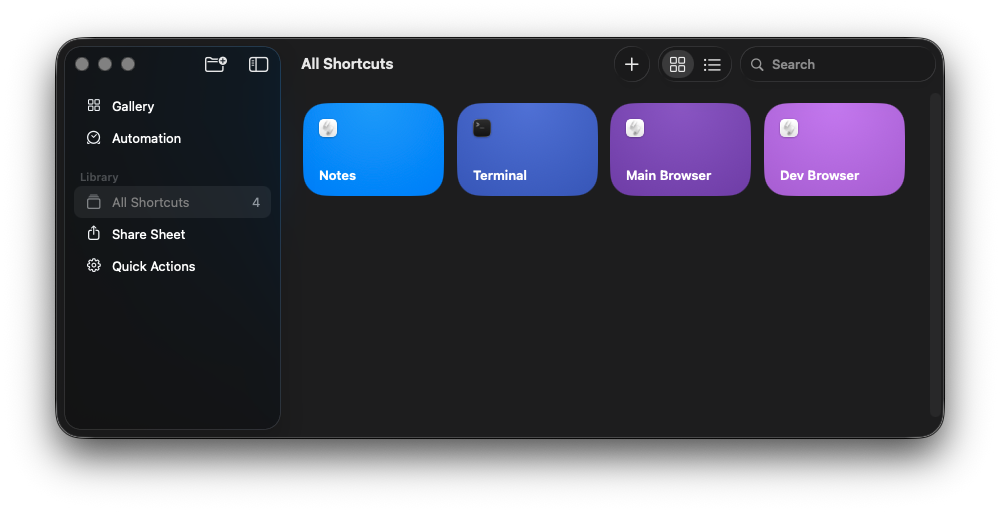

# Shortcuts

Scripts para atajos de la app Shortcuts de macOS. Cada atajo es una sola acción que corre uno de estos archivos.

Los de WezTerm y Safari acomodan la ventana igual que `Ctrl+Cmd+L` en WezTerm: pegada a la izquierda, al 85% del ancho, para dejar libre la franja derecha del escritorio. El de Obsidian la manda a la pantalla secundaria y el de Chrome lo pone en pantalla completa.

Así quedan en Shortcuts:



| Atajo | Script |
| --- | --- |
| Terminal | `wezterm-random.sh` |
| Main Browser | `safari-snap-left.applescript` |
| Notes | `obsidian-second-screen.applescript` |
| Dev Browser | `chrome-fullscreen.applescript` |

## `wezterm-random.sh`

Abre una ventana nueva de WezTerm con un tema al azar, ya acomodada a la izquierda al 85%.

**Acción en Shortcuts:** Run Shell Script, con Shell `zsh`:

```sh
~/workflow/shortcuts/wezterm-random.sh
```

**Cómo funciona:**

- Si WezTerm ya está abierto, crea la ventana con `wezterm cli spawn --new-window`. Si está cerrado, lo arranca con esa ventana.
- La ventana nace con `WORKFLOW_RANDOM_THEME=1`. En su primer prompt, `.cmds.sh` elige un tema de `_themes` distinto al tema por defecto y lo aplica con `theme`. Así `nv` y OpenCode quedan con el mismo tema.
- Luego la shell le manda a WezTerm la variable `SNAP=left` y `.wezterm.lua` acomoda la ventana con `pegar_izquierda`, la misma función de `Ctrl+Cmd+L`.

El tema tiene que aplicarlo la shell de la ventana nueva: WezTerm cambia los colores con una señal que solo puede mandar el propio pane, no un proceso de afuera.

## `safari-snap-left.applescript`

Activa Safari, abre una ventana si no hay ninguna y la acomoda a la izquierda al 85%.

**Acción en Shortcuts:** Run AppleScript, pegando el contenido del archivo.

**Notas:**

- Los `bounds` son `{izquierda, arriba, derecha, abajo}` en puntos. `{0, 31, 2176, 1080}` corresponde al monitor principal de 2560 × 1080: 2560 × 0.85 = 2176, y 31 es donde macOS deja la ventana debajo de la barra de menús. En otro monitor hay que recalcularlos.
- El `repeat 20 times` reintenta cada 0.25 s, hasta 5 s, mientras Safari termina de arrancar. Sin eso, Shortcuts falla con `every window doesn't understand the "count" message` cuando Safari estaba cerrado.

## `obsidian-second-screen.applescript`

Activa Obsidian y lo pone en la pantalla secundaria ocupando todo el espacio útil. Si solo hay una pantalla, lo pone así en la principal.

**Acción en Shortcuts:** Run AppleScript, pegando el contenido del archivo.

**Notas:**

- Las pantallas se leen al momento con `NSScreen`, así que no hay coordenadas fijas: funciona aunque cambies de monitor o de acomodo. La primera de la lista es la principal y la segunda se toma como secundaria.
- `NSScreen` se consulta en un `osascript -l JavaScript` aparte: llamado directo desde Run AppleScript (con `use framework "AppKit"`) deja colgado el atajo.
- A Obsidian se le habla por su id, `md.obsidian`: con el nombre, AppleScript resuelve a su extensión de Quick Look. `reopen` le hace abrir una ventana si la app seguía corriendo sin ninguna.
- Usa `visibleFrame`, que descuenta la barra de menús y el Dock. No es la pantalla completa de macOS, que crearía un Space aparte; es la ventana maximizada.
- Obsidian no tiene diccionario de AppleScript, así que la ventana se mueve con System Events. Shortcuts necesita permiso en Ajustes del Sistema → Privacidad y seguridad → Accesibilidad; macOS lo pide la primera vez.
- Igual que el de Safari, reintenta cada 0.25 s, hasta 10 s, mientras Obsidian termina de abrir su ventana.

## `chrome-fullscreen.applescript`

Activa Chrome, abre una ventana si no hay ninguna y la pone en pantalla completa de macOS, en su propio Space, en la pantalla principal.

**Acción en Shortcuts:** Run AppleScript, pegando el contenido del archivo.

**Notas:**

- La pantalla principal se lee igual que en el de Obsidian, con `NSScreen` en un proceso aparte.
- Antes de la pantalla completa mueve la ventana a la pantalla principal, porque macOS la pone en pantalla completa en el monitor donde esté.
- Si la ventana del frente ya está en pantalla completa, aunque sea en otra pantalla, no la toca.
- Usa System Events para la pantalla completa (el atributo `AXFullScreen`), así que necesita el mismo permiso de Accesibilidad que el de Obsidian.
- System Events ve elementos de Chrome que no son ventanas normales; por eso busca la primera con subrol `AXStandardWindow` en lugar de usar `window 1`.
